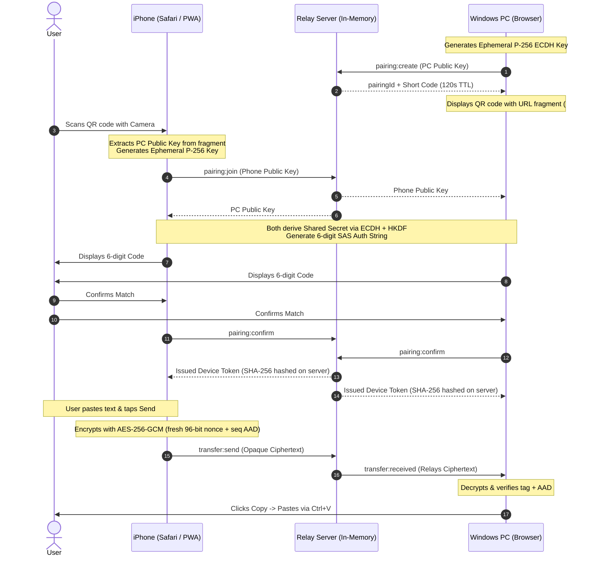

# Clipper 📋🔒

> Private, end-to-end encrypted clipboard bridge between your iPhone and Windows PC. No accounts, no database, no third-party CDNs.

---

## 1. Architecture & Data Flow



---

## 2. Folder Structure

```
clipper/
├── apps/
│   ├── server/             # Node.js + Express + Socket.IO relay
│   │   ├── src/
│   │   │   ├── app.ts      # Express setup, helmet, CORS, rate limits
│   │   │   ├── config.ts   # Zod environment configuration
│   │   │   ├── index.ts    # Server startup & graceful shutdown
│   │   │   ├── session-store.ts # In-memory session manager with sweeper
│   │   │   └── socket-handler.ts # Validated Socket.IO event router
│   │   └── Dockerfile      # Production container build
│   └── web/                # React + TypeScript + Vite + Tailwind PWA
│       ├── src/
│       │   ├── components/ # Button, StatusPill, QRScanner
│       │   ├── screens/    # IPhoneScreen & PCScreen
│       │   ├── lib/        # Theme, Toast, Socket client
│       │   ├── tokens.css  # CSS custom properties matching DESIGN.md
│       │   └── App.tsx     # Responsive / view-switching container
│       └── vite.config.ts  # PWA & dev proxy setup
├── packages/
│   └── shared/             # Shared contracts & WebCrypto implementation
│       └── src/
│           ├── crypto.ts   # SubtleCrypto ECDH, HKDF, AES-GCM
│           └── events.ts   # Zod schemas & Socket.IO contract types
├── docs/
│   ├── PLAN.md             # Execution plan
│   ├── SECURITY.md         # Threat model & cryptographic details
│   └── design-critique.md  # 5-dimension OpenDesign evaluation scoresheet
├── scripts/
│   └── check-contrast.mjs  # Mathematical WCAG AA contrast tester
├── DESIGN.md               # Design system specifications
├── CHANGELOG.md            # Technical log & decisions
├── .env.example            # Environment variables template
└── pnpm-workspace.yaml     # Monorepo configuration
```

---

## 3. Prerequisites

- **Node.js**: LTS (`>= 22.0.0` or `>= 24.0.0`).
- **Package Manager**: `pnpm` (`>= 10.0.0`). Run `corepack enable pnpm` or install via npm.

---

## 4. Quick Start (Local Development)

### Step 1: Install Dependencies
```bash
cd clipper
pnpm install
```

### Step 2: Start Relay Server
```bash
cd apps/server
pnpm dev
# Starts on http://localhost:3001
```

### Step 3: Start Web Frontend
In a new terminal:
```bash
cd apps/web
pnpm dev
# Starts on http://localhost:5173
```

Open `http://localhost:5173` in your Windows browser. Use the bottom-right switcher to toggle between **PC View** and **iPhone View** to test local pairing and transfers instantly.

---

## 5. Testing on Real iPhone with PC (HTTPS Setup)

WebCrypto, camera permissions for QR scanning, and clipboard APIs require a **Secure Context (HTTPS)**.

### Option A: Local Tunnel via Cloudflare / Ngrok (Recommended & Free)
1. Install [Cloudflare Tunnel (`cloudflared`)](https://developers.cloudflare.com/cloudflare-one/connections/connect-networks/downloads/) or `ngrok`.
2. Expose the frontend and server:
   ```bash
   cloudflared tunnel --url http://localhost:5173
   ```
3. Open the resulting HTTPS URL on your PC and iPhone.

### Option B: Local Network with Self-Signed Certificate
Run Vite with `vite --host` along with the `@vitejs/plugin-basic-ssl` plugin, then accept the self-signed certificate on your iPhone Safari under Settings -> General -> About -> Certificate Trust Settings.

---

## 6. Running Tests

```bash
# Run unit & cryptographic round-trip tests (Vitest)
pnpm test

# Run TypeScript typechecks across all packages
pnpm typecheck

# Run contrast compliance check
node scripts/check-contrast.mjs
```

---

## 7. Production Deployment

### Frontend (Vercel)
1. Import repository on [Vercel](https://vercel.com).
2. Set Root Directory to `apps/web`.
3. Build Command: `pnpm build`.
4. Output Directory: `dist`.
5. Set environment variable: `VITE_API_URL=https://your-backend.onrender.com`.

### Backend (Render / Railway)
1. Create a Web Service on [Render](https://render.com) using the root `render.yaml` or Dockerfile.
2. Ensure WebSocket connections are enabled.
3. Configure Environment Variables:
   - `NODE_ENV=production`
   - `ALLOWED_ORIGINS=https://your-frontend.vercel.app`

---

## 8. Safe Public PC Disconnect Checklist

When using Clipper on a college, library, or shared computer:
1. Click **Disconnect & Wipe** on the PC screen to wipe all in-memory keys and session storage.
2. Press <kbd>Win</kbd> + <kbd>V</kbd> to open Windows Clipboard History and click **Clear all**.
3. Close the browser tab.

---

## 9. Known Limitations

1. **iOS Background Suspension:** iOS suspends background web tabs. The iPhone app must be open when transmitting clipboard data.
2. **Windows Clipboard Ingestion:** Web browsers cannot write to the OS clipboard without an active user gesture or active focus. The user clicks **Copy** on the PC interface before pressing <kbd>Ctrl</kbd>+<kbd>V</kbd>.
3. **Relay JavaScript Trust:** End-to-end encryption in a web browser relies on trusting the server operator not to serve altered client JavaScript.
